# Entity relationship diagram

The diagram summarizes principal relationships declared in SQLAlchemy models. It is not a complete physical-schema diagram; consult migrations and model foreign keys for exact nullability, constraints, and deletion rules.

```mermaid
erDiagram
  USER ||--o{ EVENT : owns
  USER ||--o| FAMILY_WORKSPACE : owns
  FAMILY_WORKSPACE ||--o{ FAMILY_MEMBERSHIP : contains
  USER ||--o{ FAMILY_MEMBERSHIP : joins
  FAMILY_MEMBERSHIP ||--o{ FAMILY_MEMBERSHIP_PERMISSION : grants
  FAMILY_WORKSPACE ||--o{ FAMILY_WORKSPACE_INVITATION : issues
  FAMILY_WORKSPACE_INVITATION ||--o{ FAMILY_WORKSPACE_INVITATION_PERMISSION : grants
  PLANNER_PROFILE ||--o{ PLANNER_ASSIGNMENT : receives
  FAMILY_WORKSPACE ||--o{ PLANNER_ASSIGNMENT : assigned_to
  FAMILY_MEMBERSHIP ||--o| PLANNER_ASSIGNMENT : represents
  EVENT ||--o{ EVENT_FUNCTION : schedules
  EVENT ||--o{ GUEST : invites
  EVENT ||--o{ GUEST_GROUP : groups
  GUEST_GROUP ||--o{ GUEST : organizes
  GUEST ||--o{ GUEST_FUNCTION_MAPPING : assigned
  EVENT_FUNCTION ||--o{ GUEST_FUNCTION_MAPPING : selected
  GUEST ||--o{ RSVP : responds
  EVENT_FUNCTION ||--o{ RSVP : receives
  EVENT ||--o{ BUDGET_CATEGORY : budgets
  BUDGET_CATEGORY ||--o{ EXPENSE : tracks
  USER ||--o| VENDOR_PROFILE : owns
  VENDOR_PROFILE ||--o{ VENDOR_MEMBERSHIP : employs
  USER ||--o{ VENDOR_MEMBERSHIP : joins
  VENDOR_MEMBERSHIP ||--o{ VENDOR_MEMBERSHIP_PERMISSION : grants
  VENDOR_PROFILE ||--o{ VENDOR_STAFF_INVITATION : invites
  EVENT ||--o{ BOOKING : requests
  VENDOR_PROFILE ||--o{ BOOKING : supplies
  BOOKING ||--o{ BOOKING_STATUS_HISTORY : records
  BOOKING ||--o{ VENDOR_BOOKING_ASSIGNMENT : assigned
  VENDOR_MEMBERSHIP ||--o{ VENDOR_BOOKING_ASSIGNMENT : works
  EVENT ||--o{ QUOTATION : requests
  VENDOR_PROFILE ||--o{ QUOTATION : quotes
  QUOTATION ||--o{ QUOTATION_LINE_ITEM : contains
  BOOKING ||--o{ PAYMENT : may_have
  PAYMENT ||--o{ TRANSACTION : records
  PAYMENT ||--o| INVOICE : documents
  EVENT ||--o{ USER_INVITATION : publishes
  INVITATION_TEMPLATE ||--o{ USER_INVITATION : styles
  VENUE ||--o{ VENUE_AVAILABILITY : schedules
  VENDOR_PROFILE ||--o{ VENUE : may_own
  USER ||--o{ USER_SESSION : authenticates
  USER ||--o{ SECURITY_EVENT : generates
```

Tokens and permission values are stored as scalar fields/association rows. The fact that a relationship exists does not itself authorize a caller to traverse it; enforce workspace and role checks in API services.